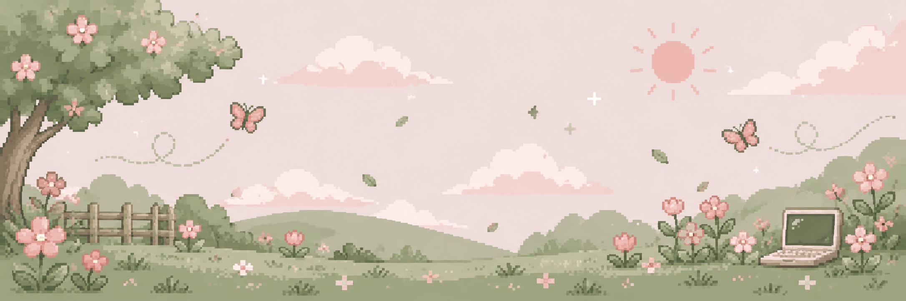

  

<h1 align="center">˚ ༘ ೀ⋆｡˚ Hello, World! I'm Chell! ♡ ˚ ༘ ೀ⋆｡˚ </h1>

  <mark><em>A curious mind in a world full of possibilities.</em></mark>

---

## 🌿 ABOUT ME

Hello! I'm a first-year **BS Information Technology student at National University**.

I'm a curious mind with a creative side, always looking for something new to learn, explore, and create. I'm still at the beginning of my coding journey, but I'm excited to see where it takes me!

- 🌱 Currently learning: Java and programming fundamentals
- 💡 Interested in: App development, web development, UI/UX, and game development
- 🎨 Creative side: Art, photography, and little creative projects
- 🌊 Outside the screen: Traveling, beach trips, music, and discovering new food
- 🦋 Fun fact: I love collecting experiences as much as I love collecting new ideas!

  <em>"There's always something new to learn, somewhere new to go, and something new to create."</em>

---

## 🍃 CURRENTLY EXPLORING

---

## 🖥️ TECH STACK

**Currently Learning**

**Tools I Use**

---

## 🌷 MY LITTLE GOALS

- [ ] Strengthen my programming fundamentals
- [ ] Explore different programming languages
- [ ] Build my first personal project
- [ ] Learn web and app development
- [ ] Improve my problem-solving skills
- [ ] Create something I'm genuinely proud of

---

## 🌼 MY PROJECT CORNER

A little collection of my learning progress, experiments, and projects.

📁 Midterm Lab Tasks

 

<table>
  <thead>
    <tr>
      <th>Activity</th>
      <th>Description</th>
      <th>Link</th>
    </tr>
  </thead>
  <tbody>
    <tr>
      <td>Lab Task 01</td>
      <td>Using 2D array to store integer values and calculate row, column, and diagonal sum.</td>
      <td><a href="https://github.com/rochell-lacandula/RL_Java_Projects/tree/2b86ec0e165a6b95169335276662e328635961c5/MIDTERMS/Labtask1">View</a></td>
    </tr>
    <tr>
      <td>Lab Task 02</td>
      <td>Using 3D array to store and process students average from different section.</td>
      <td><a href="https://github.com/rochell-lacandula/RL_Java_Projects/tree/86fdf0eb5a1028dcdac12f7604c697562a494e1d/MIDTERMS/Labtask2">View</a></td>
    </tr>
    <tr>
      <td>Lab Task 03</td>
      <td>Description</td>
      <td><a href="YOUR_LINK">View</a></td>
    </tr>
  </tbody>
</table>

🔒 Final Lab Tasks

 

<table>
  <thead>
    <tr>
      <th>Activity</th>
      <th>Description</th>
      <th>Link</th>
    </tr>
  </thead>
  <tbody>
    <tr>
      <td>Final Task 01</td>
      <td>Description</td>
      <td><a href="YOUR_LINK">View</a></td>
    </tr>
    <tr>
      <td>Final Task 02</td>
      <td>Description</td>
      <td><a href="YOUR_LINK">View</a></td>
    </tr>
  </tbody>
</table>

🔐 Personal Projects

- Coming soon...
- More ideas are loading!

---

## 💌 LET'S CONNECT!

&nbsp;

&nbsp;

&nbsp;

Always open to learning, sharing ideas, collaborating, or simply meeting fellow learners!

---

### ♡ Thank you for stopping by!

`Currently under development — just like my code.`

𓂃 ࣪˖ ִֶָ🌿🌷🌿˖ ࣪𓂃 💻 𓂃 ࣪˖ ִֶָ🌿🌷🌿 ˖ ࣪𓂃

